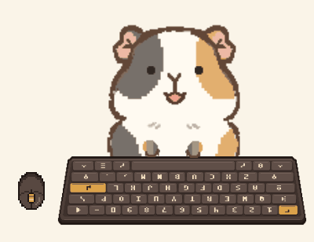

  

<h1 align="center">豚鼠键盘</h1>

  住在 Windows 和 macOS 桌面上的小荷兰猪。 
  你打字，它就用小爪敲键盘，嘴巴也会轻轻动一下。鼠标移动时它会跟着看，滚动时会伸爪拨滚轮。 

  <a href="https://github.com/gwtt/guinea-pig-keyboard">GitHub</a> ·
  <a href="https://github.com/gwtt/guinea-pig-keyboard/releases/latest/download/WheekKeys.exe">下载 Windows 版</a> ·
  <a href="https://github.com/gwtt/guinea-pig-keyboard/releases/latest/download/WheekKeys-macOS.zip">下载 macOS 版</a> ·
  <a href="https://github.com/gwtt/guinea-pig-keyboard/issues/new/choose">反馈问题</a>

  
  

  

Windows 10 或 11 用户下载后双击 `WheekKeys.exe` 即可。Mac 用户（macOS 11 或更新版本）解压后把 `WheekKeys.app` 拖进「应用程序」。第一次打开，从菜单栏的荷兰猪图标选择「启用输入监控权限」，允许后重新打开桌宠，它就能跟着你打字了。Mac 版尚未经 Apple 公证，若系统阻止打开，可查看 [Apple 的说明](https://support.apple.com/zh-cn/102445)。

首次打开时，荷兰猪使用三花，大小为 58%。按住可拖动，双击摸头，右键打开设置面板。设置里可以切换外观与键鼠皮肤、调节大小和透明度，也可以开启按键气泡、鼠标穿透或开机自启。开启鼠标穿透后，Windows 上按住 Alt 可临时拖动，也可从 Windows 托盘或 macOS 菜单栏打开设置。

Windows 和 macOS 都有 22 款内置外观，其中 8 款是手绘趴趴猪，另有 3 套键鼠皮肤。

启动桌宠或打开设置时会自动检查更新。发现新版后，点击设置顶部的「更新到最新版本」即可在 Windows 上安装更新，或在 Mac 上下载新版安装包。

快速来回晃动鼠标，小猪会原地扭身，连蹦两下，这就是荷兰猪兴奋时的「爆米花跳」。连按四次退格键，它会慌张地瞪大眼睛。Windows 上，使用提供标准 HID 笔报告的数位板时，小猪会握笔，笔尖会随落笔轻重变化。

  

### 隐私说明

**具体键位和输入文字不会上传。** 键位只在本机内存里驱动动画，设置文件仅保存累计次数。桌宠不保存逐键记录和笔迹。

支持联机功能。加入房间后会分享昵称、外观和累计次数。开启「同步敲击和点击动画」后，好友还能看到通用拍键和鼠标点击动作。该隐私说明适用于本版本，旧版本仍可能发送具体键位。

非盈利的vibe项目，纯粹分享给同样喜欢荷兰猪的朋友。

感谢 [BongoCat](https://github.com/KeyLimePie7/BongoCat)、[DesktopKitty](https://github.com/MayankArambhi/DesktopKitty) 和 [KuroCat](https://github.com/chanke17/KuroCat) 提供的参考。
